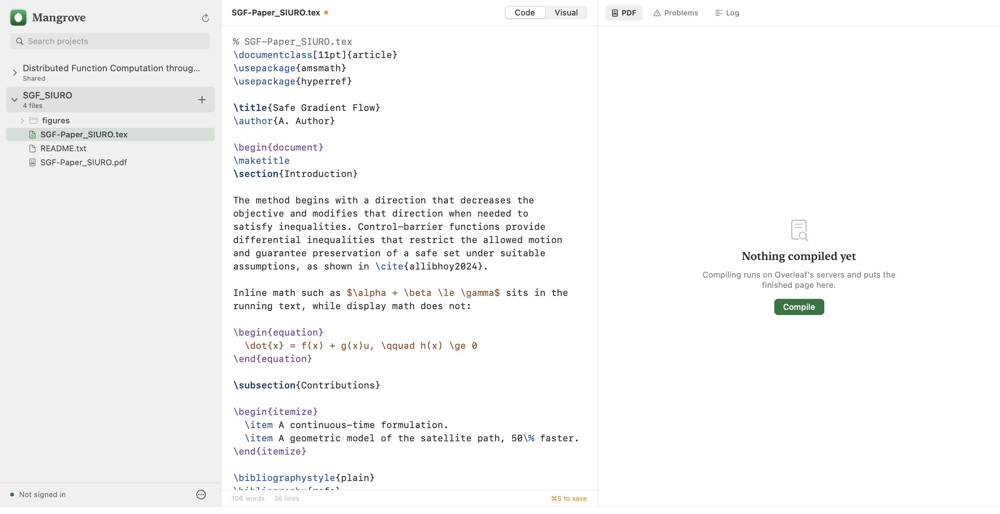
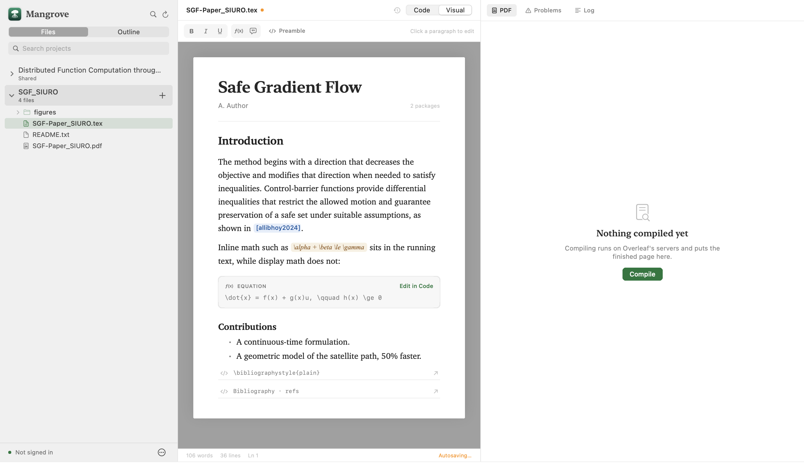

# Mangrove

Mangrove is a native macOS client for [Overleaf](https://www.overleaf.com): browse your projects,
edit LaTeX in a real desktop editor, compile on Overleaf's servers and read the
resulting PDF — without a browser tab. It keeps working when the network is gone,
and merges a collaborator's saved changes instead of overwriting them. It is a
SwiftUI app (Swift Package Manager, no Xcode project required) using `URLSession`,
`WKWebView`, `PDFKit` and the macOS Keychain.

> Unofficial and not affiliated with Overleaf.



## Requirements

- macOS 12 (Monterey) or later
- Xcode or the Xcode command line tools (`swift` on your `PATH`)

## Build and run

```sh
./scripts/build-app.sh          # release build → build/Mangrove.app
open build/Mangrove.app
```

Pass `debug` for a faster, larger build:

```sh
./scripts/build-app.sh debug
```

Run the tests with `swift test`.

## Signing in

Overleaf has no OAuth flow for third-party clients, so the app never sees your
password. Two options, both on the welcome screen:

1. **Sign in to Overleaf** — opens the real Overleaf login page in an embedded
   web view. Password, SSO and two-factor all work exactly as they do on the
   website. The app watches for the session cookie to appear and then takes over.
2. **I already have a session cookie** — paste the `Cookie:` request header from a
   logged-in `overleaf.com` request (browser devtools → Network → any request →
   Request Headers). Useful if your account signs in through a provider that
   refuses to run inside an embedded browser.

Either way the session cookie is stored in the macOS **Keychain** and reused on
later launches. Sign out from **Project → Sign Out** to remove it.

## What it does

- **Project list** of everything you own or collaborate on, with search and a
  badge for projects you only have read access to.
- **Local working copy** — opening a project downloads it once, so the file tree
  and editor respond instantly.
- **Tabs and an outline** — open files stay open in a tab strip (⌥⌘W closes the
  active one), and the sidebar switches between **Files** and an **Outline** of
  the current document's parts, chapters and sections, with a word count for
  each. Clicking a heading takes the source there.
- **Citation and reference completion** — typing `{` inside `\cite`, `\citep`,
  `\ref`, `\autoref` and friends offers the keys in the project's `.bib` files
  and the labels in its documents, so a typo cannot silently become `??`.
- **Find in project** — ⇧⌘F searches every text file, shows the line and a
  preview, and replaces all matches in one operation (which then saves and
  merges like any other edit).
- **Native editor** for `.tex`, `.bib`, `.sty` and other text files, with
  monospaced type, syntax colouring, word and line counts, and unsaved markers in
  the file tree and toolbar.
- **Writing assistance** — pressing Return after a complete `\begin{...}` line
  inserts the matching `\end{...}` and leaves the caret in the body; typing the
  closing `}` of the begin line does the same. Tab expands LaTeX snippets
  (`\fig`, `\tab`, `\frac`, `\cite`, `section`, …) with the caret in the first
  argument.
- **Live writing checks** — the file is checked locally shortly after you stop
  typing: unbalanced braces, unclosed or mismatched environments, duplicate
  labels, and references or citations with no target. When
  [ChkTeX](https://www.nongnu.org/chktex/) is installed, its typographic warnings
  are folded in. Results appear under Problems in the build pane, separate from
  compiler errors, and never require a compile.
- **Visual mode** for `.tex` files — **Code / Visual** in the document header, or
  ⌥⌘E. Headings, paragraphs, lists and inline emphasis appear as a typeset page
  you can type into; the `.tex` file stays the source of truth and is rewritten
  in place as you edit (see [Visual editing](#visual-editing)).
- **Uploading** — **⌘⇧U**, or the plus menu beside the selected project, adds
  files from disk: figures, `.bib` files, classes, anything. They are copied into
  the working copy and sent like an edit, so an upload made offline waits in the
  same queue and arrives on reconnect. A folder's context menu uploads straight
  into that folder; otherwise files land beside the open file.
- **Compile** on Overleaf's own servers (draft mode included) and read the PDF in
  a native `PDFKit` view. The build pane has three tabs — **PDF**, **Problems**
  and **Log** — and a failed build switches to Problems automatically. Each problem
  carries its file and line, and clicking one opens the file at that line; the raw
  log is still there, one tab away. **Export PDF** in the build pane (or ⇧⌘E)
  saves the compiled page wherever you like, named after the project.
- **Idle compile** — with the page visible, typing pauses for about twenty seconds
  and the document rebuilds on its own. The previous page stays on screen while
  the new one downloads, and the viewer keeps its page, scroll position and zoom
  across the rebuild. The build pane shows **Auto-compiled** rather than pulling
  you to another tab. Toggle it in **Project → Auto Compile**; ⌘B still compiles
  on demand, and nothing is compiled while a merge is unresolved or while the
  page is hidden.
- **SyncTeX** — after a local build, double-click a word on the page to open its
  source line, or ⇧⌘J to scroll the page to the caret's line. Remote builds do
  not expose their `.synctex.gz`, so the jump controls appear only for pages
  compiled on this Mac.
- **File management** — new files and folders, rename, move and delete, from the
  file tree's context menus. Changes go to Overleaf first and are mirrored locally
  only after it accepts them, so a failed operation leaves both sides untouched.
- **Drop images** — dropping PNG/PDF/JPEG files onto the source copies them into
  the document's folder, uploads them and inserts a ready `\includegraphics` line
  at the drop point.
- **Version history and autosave** — every successful upload keeps a local
  snapshot (History, from the clock beside the document name); autosave sends
  changes after a few idle seconds by default, and can be turned off in
  **Project → Autosave**. Snapshots are local, so they are not a substitute for
  Overleaf's own history.
- **Collaborator presence** — while a project is open the realtime socket stays
  connected, showing the initials of other editors and a **Reload and Merge**
  notice when files change elsewhere. This is presence and refresh-on-change, not
  live operational transformation.
- **Saving** — ⌘S writes the file to the working copy and uploads it, and ⌘B
  saves every changed file before compiling. Typing is mirrored to disk shortly
  after you stop, so a crash cannot lose it; **⌘⇧C copies the open file** to the
  clipboard.
- **Offline editing** — with no connection, saves go to a queue written to disk
  that survives quitting. It is pushed automatically the moment the connection
  returns, and the status bar shows how many files are waiting.
- **Merging** — before every upload the app re-reads the project and compares it
  with the copy it last saw. If someone saved in the meantime, the two versions
  are merged line by line against that common ancestor instead of one silently
  replacing the other. Regions both sides changed are shown side by side and you
  choose what to keep; nothing is uploaded until you decide.
- **Offline compiling** — when Overleaf is unreachable and a TeX distribution is
  installed on this Mac, ⌘B compiles locally and shows the PDF as usual. Without
  TeX the compile is queued and runs when the connection returns.
- **Non-blocking notices** — problems appear as a dismissible banner instead of an
  alert, so they never interrupt what you are typing.

| Shortcut | Action |
|---|---|
| ⌘B | Save and compile |
| Tab | Expand a LaTeX snippet at the caret |
| Return | Close a `\begin{...}` line with its `\end{...}` |
| ⇧⌘E | Export the compiled PDF |
| ⌘S | Save the current file to Overleaf |
| ⌥⌘E | Switch between Code and Visual editing |
| ⌥⌘W | Close the active file tab |
| ⇧⌘F | Find and replace across the project |
| ⇧⌘J | Reveal the caret's line on a locally built page |
| ⌘⇧U | Upload files from disk |
| ⌘⇧S | Sync queued changes now |
| ⌥⌘B | Compile locally (requires TeX on this Mac) |
| ⌘⇧C | Copy the open file to the clipboard |
| ⌘R | Reload the project from Overleaf |

## Offline editing and merging

The working copy is not a cache: `~/Library/Application Support/Mangrove/Projects/<id>`
is the document while you edit, and `State/<id>.json` records which files differ
from what Overleaf has. Both survive quitting, so a dropped connection costs you a
sync, not your work. A queued compile is stored in the same place.

Every upload starts by downloading the project archive again. Comparing that with
the last remote copy the app saw (`Bases/<id>` — the merge base) and with the local
file gives one of four outcomes:

| Local | Remote | Result |
|---|---|---|
| unchanged | changed | take Overleaf's copy |
| changed | unchanged | upload |
| changed | changed elsewhere | merge both |
| changed same lines | changed same lines | ask, region by region |

The merge is ordinary `diff3`: edits to separate lines combine, and only
overlapping ones become conflicts. A conflict never blocks the file — the local
copy stays exactly as it was until you open **Project → Resolve Merge Conflicts…**.

Two honest limits. This is merge-on-save, not Overleaf's live collaboration: edits
someone is making in the browser without saving are invisible here. And because an
upload replaces the whole file, a save that lands on Overleaf in the moment between
this app's download and its upload is not part of the comparison — the window is
one upload, not the whole session.

Local compilation needs a TeX installation; nothing is bundled. `latexmk` is
preferred, with `pdflatex` plus `bibtex` as a fallback, and the search covers
MacTeX/BasicTeX (`/Library/TeX/texbin`), Homebrew, MacPorts, TinyTeX under
`~/Library/TinyTeX` and TeX Live under `/usr/local/texlive`.

## Writing assistance

Two editor behaviours are pure functions over the buffer, so they can be tested
without an `NSTextView`:

- `LaTeXAssistance.environmentClose` fires on Return at the end of a line that is
  only `\begin{env}` (optional arguments allowed), and after a typed `}` finishes
  such a line. It inserts a blank body line and an indented `\end{env}`, then puts
the caret in the body. It does nothing when the following block already closes
that environment, so pressing Return twice cannot stack two ends.
- `LaTeXAssistance.snippet` expands a trigger on Tab. Triggers are whole words, so
  prose ending in "fig" is left alone, and a trigger inside a comment is ignored.

The checks in `LaTeXLint` are local and run about a second after typing stops.
They cover balanced braces, environments, duplicate labels and unknown `\ref` or
`\cite` keys (reference checks need the project index, so they are skipped before
the first index is built). ChkTeX is optional: when found on `PATH` or beside the
TeX toolchain, it checks a temporary copy of the unsaved buffer. Its output is
parsed for file, line, severity and message. Diagnostics from the compiler and
from these checks are kept separately, so a build never wipes warnings you have
not addressed yet.

## Visual editing

Visual mode is a formatted view of the file you already have open, not a second
format: the `.tex` source is authoritative and the visual page is generated from
it on every change. There is no import step and nothing is stored twice.

Every construct the parser recognises remembers the exact source range it came
from, so editing a heading rewrites only that heading's argument. A paragraph edit
replaces the paragraph's text, inline formatting is translated back to `\emph{}`,
`\textbf{}` and friends, and a list item is rewritten in place. Anything the
parser cannot model safely — an unknown environment, raw macros, a figure — is
shown as a read-only card with **Edit in Code** next to it; selecting it in code
and returning to Visual resumes editing around it. Comments in the preamble and
between blocks survive untouched, as does the layout of everything you did not
edit.

This is deliberately not a full LaTeX editor. It handles the structure of an
ordinary paper — title, headings, paragraphs, itemised and enumerated lists,
definitions, verbatim blocks, figures, tables, display math, and the common
inline markup — and treats everything else as opaque source rather than guessing.
Multi-paragraph list items are left to code mode, because rewriting them visually
would change where the `\item` boundaries fall. If a file contains a construct that
cannot round-trip, the visual pane says so instead of silently dropping it.



## How it works

Overleaf publishes no supported API for reading and writing existing projects, so
this app uses the same session-authenticated routes as the Overleaf web editor.
They were verified against Overleaf's route table
(`services/web/app/src/router.mjs` in [overleaf/overleaf](https://github.com/overleaf/overleaf)):

| Purpose | Endpoint |
|---|---|
| Session check, project list | `GET /user/projects` |
| CSRF token for writes | `GET /dev/csrf` |
| Project contents | `GET /Project/:id/download/zip` |
| Root folder id (for uploads) | realtime channel: `GET /socket.io/1/` then `joinProjectResponse` |
| Create/overwrite a file | `POST /Project/:id/upload?folder_id=…` (multipart `qqfile`) |
| Compile | `POST /project/:id/compile` |
| Compiled PDF and log | the `outputFiles[].url` values from the compile response |

Four details that matter:

- **CSRF.** Writes need an `x-csrf-token` header. csurf stores its secret *in the
  session*, so the session cookie Overleaf returns alongside a token has to be
  kept — the client merges refreshed `Set-Cookie` values back into the stored
  session. Dropping them is what makes later writes fail with HTTP 403.
- **Content access.** `GET /project/:id/entities` lists paths but not document
  ids, and the per-document write route is private-API-only. The zip download and
  the upload route are the cookie-authenticated way in, which is why the app keeps
  a local working copy instead of editing documents one by one.
- **Uploads need a folder id.** `POST /Project/:id/upload` resolves the target
  with `folder_id` from the query string; with a missing id `findElement` throws
  (HTTP 404), and without one `upsertFile` fails with `folder_not_found`
  (HTTP 422). No HTTP route exposes folder ids, so the app reads the project's
  root folder id from the realtime channel's `joinProjectResponse` and sends the
  file path relative to it — Overleaf creates any folders along the way.
  The id is cached per project for the run.
- **Compile builds the saved copy.** Overleaf compiles whatever it has stored, so
  `⌘B` uploads every changed file before it compiles. A save that fails is
  reported and the compile still runs, but then the PDF is Overleaf's saved copy.

## The realtime channel

Saves depend on one detail of Overleaf's realtime service, and it is not what its
modern name suggests. Overleaf pins a **fork of socket.io 0.9**, which predates
Engine.IO entirely. Saves use a short-lived join for the folder id; a second,
persistent join powers presence and remote-change notices. Both speak this wire
format:

- the handshake is `GET /socket.io/1/?t=…&projectId=…`, answering
  `sid:heartbeat:closeTimeout:transports`;
- the transport is `wss://<host>/socket.io/1/websocket/<sid>`;
- frames are text packets `type:id:endpoint:data`, e.g.
  `5:::{"name":"joinProjectResponse","args":[{…}]}`;
- the server joins the project **by itself** from the `projectId` query parameter,
  so the client has to emit nothing at all.

Three things this app has to do that are easy to get wrong:

- **Pin HTTP/1.1.** `URLSessionWebSocketTask` negotiates HTTP/2 over ALPN, and
  Overleaf's load balancer answers HTTP/2 upgrades with **502** while the byte-
  identical request over HTTP/1.1 gets **101**. The upgrade is therefore done on
  an `NWConnection` with ALPN pinned to `http/1.1`.
- **Carry the affinity cookie.** The load balancer sets a `GCLB` cookie that pins
  the session id to one backend; omit it and the upgrade lands where the id is
  unknown and returns 502. It is set host-only without a `Domain` attribute, which
  is why it is parsed from the raw header rather than through `HTTPCookie`.
- **Retry the upgrade.** Even with the cookie, roughly one attempt in four lands
  on the wrong backend (measured). Each retry performs a fresh handshake — new
  session id, new affinity cookie — which resolves it.

## Limitations

- **Undocumented API.** These routes are implementation details of the Overleaf
  web app and can change without notice; a change on their side can break this
  app. It is designed to fail with a clear message rather than corrupt a project.
- **Presence, not live collaboration.** A realtime stream stays open for
  collaborator presence and tree-change notices, but this app does not run
  Overleaf's operational-transform protocol: you will not see cursors or
  character-by-character edits. Use **Reload and Merge** when someone else
  changes the project; saving merges whatever they have already saved. The
  presence event names are inferred from Overleaf's client tracking and are
  best-effort — if they change, the toolbar simply shows nobody.
- **SyncTeX needs a local build.** The map is read from the build directory on
  this Mac. Overleaf does not expose `.synctex.gz` through the routes the app
  uses, so PDF/source jumps are disabled for remote builds.
- **File operations are id-based.** Rename, move and delete resolve the entity
  ids from the realtime join. They update Overleaf first and the working copy
  only after it accepts; browser-side changes made between the join and the
  operation can make an id stale, in which case the app reports it instead of
  guessing. **New File** still uses the upload route, so Overleaf stores the
  result as an uploaded file rather than an editor document.
- **History is local.** Up to 25 snapshots per file are kept in
  `~/Library/Application Support/Mangrove/History`. They are not Overleaf's
  version history and are not uploaded. Renaming a file starts a new history,
  because the snapshots are keyed by path.
- **Autosave is not unconditional.** It only runs while the project is online,
  no merge is pending and nothing is compiling; otherwise changes stay in the
  crash-safe draft and the offline queue. A merge conflict raised by autosave
  opens the same conflict sheet as a manual save.
- **Uploads replace same-named files.** Choosing a file whose name already exists
  in the target folder replaces it, with no rename prompt. Files over Overleaf's
  50 MB limit are refused before anything is sent.
- **Saving writes whole files.** An edit replaces the document's contents rather
  than applying an operation at a position, so history records a single replace
  for that save instead of fine-grained typing.
- **No tracked changes, comments or project creation.** The local History sheet
  is a safety net, not a replacement for Overleaf's own history.
- Compiles run on Overleaf's servers and count against your account's limits;
  the download route is rate limited by Overleaf, so avoid loading projects in a
  tight loop.

## Design

The subject is typesetting, so the interface borrows the conventions of a set
page: hairline rules instead of boxes and shadows, a serif for editorial moments
(project and page titles), monospace for source, and the mark's green reserved
for signal — selection, compiling, success. Everything else is ink and grey.

Because the source and the compiled page are the point of the app, the projects
and their files share a single sidebar of about 215pt: the selected project
unfolds in place to show its files, so there is no second column taking width
from the work. The window also has a minimum width of 1240pt so the two working
panes never collapse; below that the editor cannot show a reasonable line length.

The editor colours LaTeX the way the web editor does — comments grey, commands
blue, environments violet, math amber — with every colour tuned separately for
light and dark. The palette deliberately avoids green, which in this app means
signal rather than syntax. Colouring is a single-pass scan rather than a full
parser, so unfinished input (a half-typed `\begin{…}`) still reads sensibly.


## Project layout

```
Sources/Mangrove/
  OverleafClient.swift      HTTP client: session, CSRF, zip, upload, compile
  RealtimeClient.swift      socket.io 0.9 over raw HTTP/1.1; folder ids, diagnostics
  SessionStore.swift        Keychain-backed session and cookie handling
  ProjectWorkspace.swift    Working copy, merge bases, persisted pending state
  FileImport.swift          Where files chosen from disk land in a project
  VisualDocument.swift      Parses .tex into blocks with exact source ranges
  InlineLaTeX.swift         Inline markup ⇄ attributed text, and the rewriter
  DocumentOutline.swift     Headings, line numbers and per-section word counts
  CompletionIndex.swift     Bib keys, labels and cite/ref context at the caret
  ProjectSearch.swift       Project-wide find and replace
  ProjectHistory.swift      Local upload snapshots and a line diff
  ProjectEntities.swift     Docs/files/folders and ids from the realtime join
  SyncTeX.swift             Source ⇄ PDF mapping through the synctex CLI
  BuildDiagnostics.swift    TeX log and validation problems → ordered diagnostics
  LineMerge.swift           diff3 merge, sync decisions, offline classification
  LocalLaTeX.swift          Finds and runs a local TeX toolchain
  IdleCompile.swift         The debounce and gates for automatic compilation
  LaTeXAssistance.swift     Environment auto-close and Tab snippet expansion
  LaTeXLint.swift           Built-in syntax checks plus optional ChkTeX
  NetworkMonitor.swift      Path monitoring that triggers queued sync
  AppState.swift            Session lifecycle, saving, merging, offline queue
  Models.swift              Projects, output files, file tree, errors
  Views/Theme.swift         Design tokens, the app mark, shared components
  Views/SourceEditor.swift  LaTeX editor (NSTextView) and its highlighting
  Views/VisualEditor.swift  The visual page, format bar and inline text views
  Views/BuildPane.swift     PDF / Problems / Log tabs, jump-to-source
  Views/ProjectTools.swift  Search, history and file-operation sheets
  Views/MergeConflictView.swift  Side-by-side conflict resolution
  Views/                    SwiftUI: sign-in, sidebar, editor, PDFKit pane
Tests/MangroveTests/ Session/cookie handling, diff3, sync planning, offline builds,
                     visual round-trip, build diagnostics
scripts/make-icon.swift     Renders the app icon (green tile + leaf mark)
scripts/build-app.sh        Builds and assembles the .app bundle
Screenshots/                Rendered views used in this README
```

If a save ever fails for you, `~/Library/Application Support/Mangrove/sync.log`
records each attempt — which step ran, and what Overleaf answered. It contains no
cookies, file contents or typed text.

The app icon is generated rather than hand-drawn: `scripts/make-icon.swift`
renders a 1024px master with Core Graphics and `build-app.sh` turns it into an
`.icns`. The same leaf is drawn in SwiftUI by `LeafMark` so the mark stays crisp
inside the app at any size.
